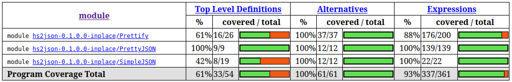

# hs2json

Biblioteca Haskell que representa dados JSON, formata a saída com um pretty printer e testa o código com QuickCheck. A dupla desenvolveu o projeto seguindo o tutorial [*Construindo e Testando uma Biblioteca Haskell*](https://lambdageo-edu.github.io/lambdageo-tutorials/haskell/), do LambdaGeo.

## Vídeo de apresentação

**[Assista ao vídeo no Google Drive](https://drive.google.com/file/d/118JS9y7MCfGDxxQOHfBuXSg1Je7WZ5rB/view?usp=sharing)**

## Dupla

- Antonio Lucas da Silva Vale
- Izadora de Paula Santos Lima

## Requisitos

GHC 9.x e cabal-install 3.x.

## Como usar

```bash
cabal build
cabal run hs2json
cabal test
```

O `cabal run` imprime o mesmo JSON duas vezes, primeiro na forma compacta e depois indentado. O `cabal test` roda 29 propriedades do QuickCheck.

Para gerar o relatório de cobertura, rode o comando abaixo. O Cabal grava o relatório em HTML dentro de `dist-newstyle/`.

```bash
cabal test --enable-coverage
```

## Módulos

| Módulo | O que faz |
|---|---|
| `SimpleJSON` | Define o tipo `JValue` e os accessors `getString`, `getInt`, `getDouble`, `getBool`, `getObject`, `getArray` e `isNull` |
| `PutJSON` | Primeira versão do renderizador, que gera uma `String` direto |
| `Prettify` | Pretty printer genérico construído sobre o tipo `Doc` |
| `PrettyJSON` | Converte um `JValue` em `Doc`, escapa as strings e indenta objetos e arrays |
| `QuickTests` | Propriedades de exemplo sobre uma função de ordenação |

## Testes

As propriedades ficam em `test/Spec.hs`. Elas verificam os construtores do `Doc`, os accessors do `JValue`, o escape de strings e a equivalência entre a saída compacta e a indentada. O gerador de `JValue` usa `sized` e `resize` para limitar a profundidade da árvore e o tamanho das listas.

A imagem abaixo mostra a cobertura medida com HPC.



As declarações não chegam a 100% porque o HPC conta os métodos gerados pelo `deriving`, e os testes não chamam todos.

## Mudanças em relação ao tutorial

- O escape converte todo caractere fora do ASCII imprimível em `\uXXXX`. O código original deixava acentos como `é` saírem sem escape.
- O exercício de indentação ganhou o construtor `Nest` no `Doc`, e o `series` passou a usar `group`, `nest` e `line`.
- O gerador de `Doc` usa `sized` para não criar árvores grandes demais. Quando um teste falha, o `genericShrink` reduz o contraexemplo, mas só aceita versões que o próprio gerador poderia ter criado.
